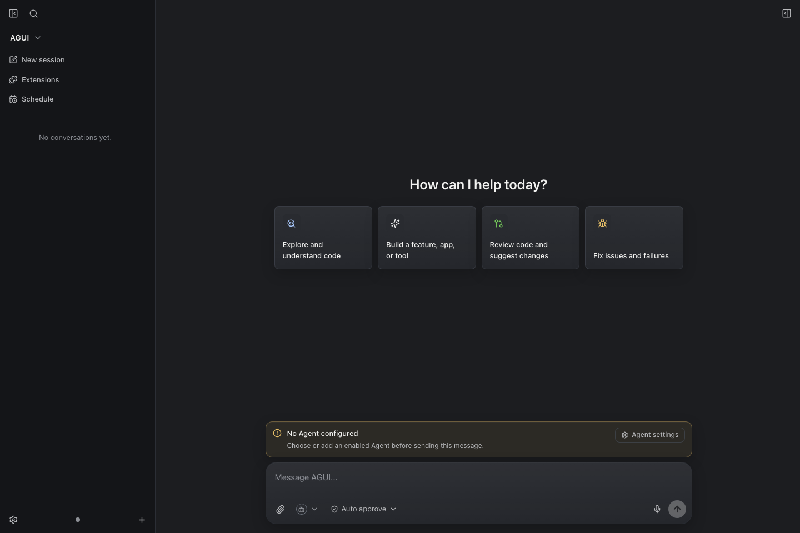
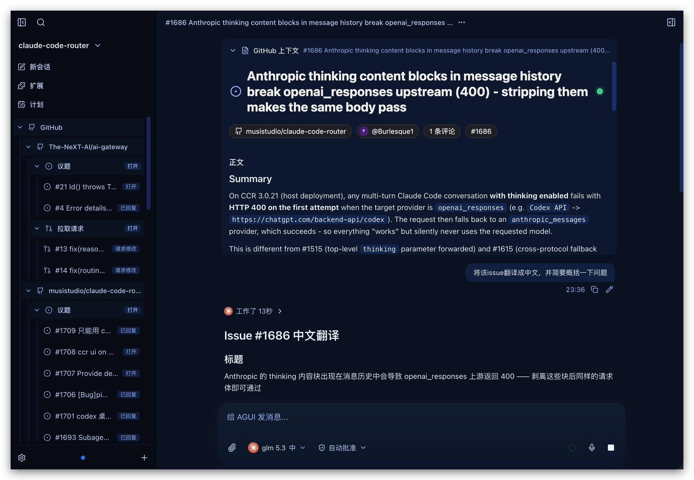

# AGUI Desktop

[中文](README_zh.md)

**A universal desktop and web workspace for coding agents.**

AGUI Desktop gives engineering teams one polished interface for many agent
runtimes. Bring Codex, Claude Code, OpenCode, Pi, Grok, Kimi, Kilo, or any
Agent Server Protocol (ASP) compatible agent into a single workspace with shared
sessions, approvals, browser automation, files, terminals, and extensible UI.

> **Alpha preview.** AGUI Desktop is ready for developer trials, integration
> work, and community feedback while the platform continues to evolve.





## Why AGUI

Modern coding agents are powerful. Teams still need a dependable client that
feels native, respects local workflows, and can grow with new providers.
AGUI Desktop turns agent runtime diversity into a unified product experience.

- **One workspace for every agent**: route sessions through ASP and switch
  providers without changing the user experience.
- **Human control built in**: review command, file, and network approvals from
  the same conversation surface.
- **Desktop power, web reach**: run as an Electron app or deploy the pure-web
  runtime through `@agui/server`.
- **Automation beside the chat**: give agents controlled browser, terminal, and
  IDE-panel capabilities through the runtime.
- **Extension-ready from day one**: add panels, custom chat components, themes,
  commands, MCP servers, and skills.

## Built For

- Agent platform builders who want a client shell for ASP-compatible runtimes
- Developer tool teams building branded downstream coding-agent products
- Internal platform teams standardizing agent access, approvals, and workspace
  policy
- Researchers and protocol builders testing multi-agent UX, native adapters,
  and portable agent sessions

## Product Highlights

### Agent Choice

AGUI ships with native adapters for Codex app-server, Claude Code stream-json,
OpenCode server, Pi RPC, Grok headless CLI, and Kimi headless CLI. It also
supports Kilo and custom ASP agents over stdio, persistent stdio, WebSocket, or
SSH.

### ASP-Native Runtime

Agent Server Protocol v1 gives the renderer a stable stream for text, reasoning,
plans, tools, diffs, resources, artifacts, usage, approvals, and questions. The
same contract powers Electron and the Node server runtime.

### Safe Operator Loop

AGUI keeps sensitive actions visible. Agents can request command execution, file
changes, network access, and structured user input while the client keeps the
approval flow close to the work.

### Browser And Workspace Automation

The built-in MCP Gateway can expose app panels, terminals, IDE files, and
in-app browser automation to agents. Providers can open pages, inspect state,
click, type, capture screenshots, and coordinate browser workflows through
controlled tools.

### Extensible Product Surface

Extensions can contribute side panels, custom renderers, UI schemas, commands,
themes, MCP resources, and skills. AGUI is designed for teams that want to ship
their own agent experience on top of a shared runtime foundation.

## Get Started

```bash
pnpm install
pnpm dev
```

`pnpm dev` starts the Vite renderer, Electron main-process TypeScript watcher,
and Electron window.

Run a browser-only preview:

```bash
pnpm dev:web
```

Run the pure-web app with the local Node runtime:

```bash
pnpm dev:pure-web
```

Start the production server after building:

```bash
pnpm server
```

## Documentation

The docs site lives in `docs/` and includes English and Simplified Chinese
content.

```bash
pnpm docs:dev
pnpm docs:build
pnpm docs:preview
```

## Authentication

`@agui/server` includes WebAuth, OAuth/OIDC, shared-token, and disabled-auth
modes for different deployment shapes.

| Mode       | Fit                                                      |
| ---------- | -------------------------------------------------------- |
| `webauth`  | Built-in login for simple deployments                    |
| `oauth`    | External OAuth/OIDC identity providers                   |
| `token`    | Trusted single-tenant deployments behind a reverse proxy |
| `disabled` | Local development and isolated internal environments     |

Single-user WebAuth deployments can start with:

```bash
AG_UI_WEBAUTH_USERNAME=admin
AG_UI_WEBAUTH_PASSWORD=...
```

OAuth/OIDC deployments use:

```bash
AG_UI_AUTH_MODE=oauth
AG_UI_PUBLIC_URL=https://agui.example.com
AG_UI_OAUTH_ISSUER=https://issuer.example.com
AG_UI_OAUTH_CLIENT_ID=...
AG_UI_OAUTH_CLIENT_SECRET=...
```

Tenant data is stored under `$AG_UI_USER_DATA_DIR/tenants/<tenant-key>/`.
Workspace roots can be mapped with `AG_UI_TENANT_WORKSPACE_ROOTS` and templates
such as `{tenant}`, `{tenantId}`, `{user}`, `{userId}`, and `{emailDomain}`.

## Repository Map

```text
.
├── packages/
│   ├── app/                 Renderer React UI, ASP bridge, and product shell
│   ├── asp/                 ASP protocol, transports, providers, and adapters
│   ├── electron/            Electron shell, IPC, and preload
│   ├── extensions/          Extension manifest, IPC, and UI schema types
│   ├── runtime/             Shared Electron and Node server runtime
│   └── server/              Pure-web server entrypoint
├── extensions/              First-party extension examples
├── docs/                    Documentation site
└── scripts/                 Development, test, packaging, and release tools
```

Useful package entrypoints:

- `@agui/app`: frontend extension UI API and contribution registry
- `@agui/asp`: `./manager`, `./protocol`, `./transport`, `./provider-store`,
  and `./types`
- `@agui/runtime`: shared runtime for provider management, sessions, terminals,
  IDE files, MCP Gateway, and JSON-RPC
- `@agui/server`: deployable pure-web runtime entrypoint

## Validate

```bash
pnpm typecheck
pnpm test:asp
pnpm test:extensions
pnpm build:app
```

`test:asp` runs locally and covers provider negotiation, reasoning, plans,
tools, diffs, usage, completion events, approvals, questions, and native adapter
projection.

## Package And Release

```bash
pnpm pack:frontend
pnpm pack:server
pnpm pack:electron
```

Release outputs are written under `release/`:

- `release/frontend/`: static frontend assets
- `release/server/`: deployable `@agui/server` bundle with static assets
- `release/electron/`: platform installers such as macOS DMG/ZIP, Windows NSIS,
  and Linux AppImage

Publish npm packages and upload the current platform's Electron installers to
GitHub Releases:

```bash
pnpm release
pnpm release:dry-run
```

Common options:

```bash
pnpm release -- --tag v0.1.0
pnpm release -- --skip-npm
pnpm release -- --skip-electron
pnpm release -- --npm-tag next --github-release prerelease
```

Production desktop distribution should include platform code signing. Generate
macOS, Windows, and Linux installers on their corresponding platforms.

## License And Trademarks

AGUI Desktop is released under the [MIT License](LICENSE). AGUI is an
independent community project. Compatibility references belong to their
respective owners and appear for interoperability context. See
[NOTICE](NOTICE.md).
